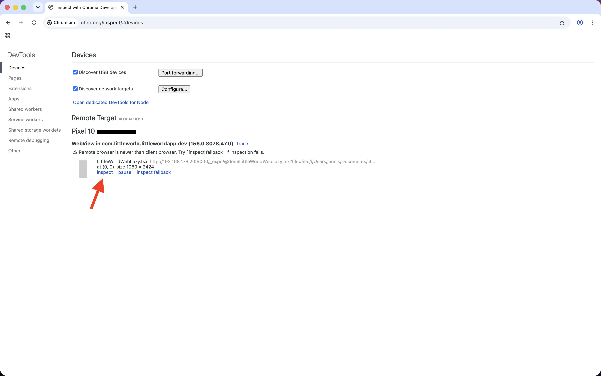
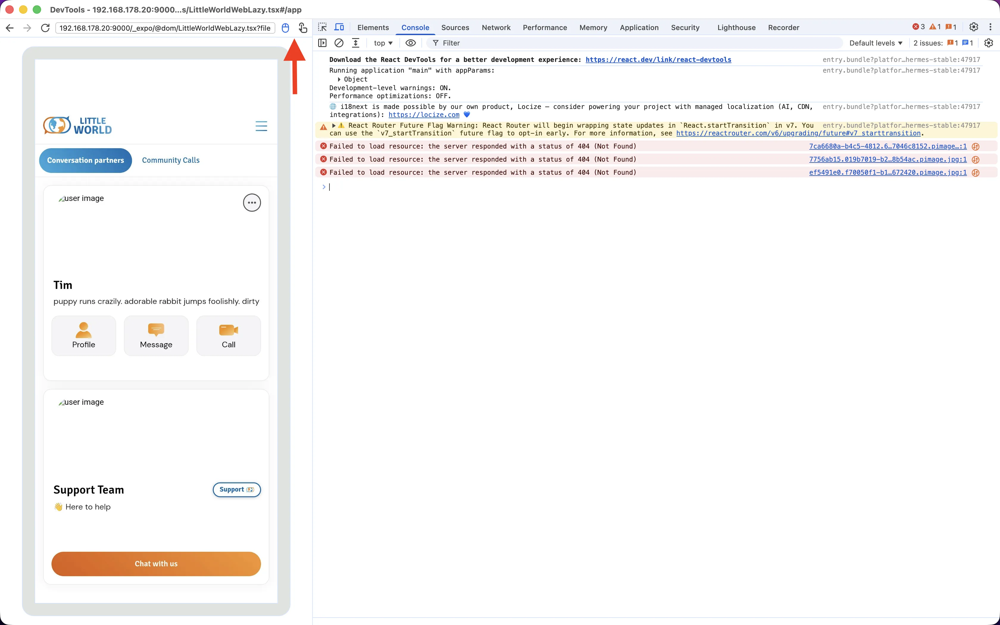
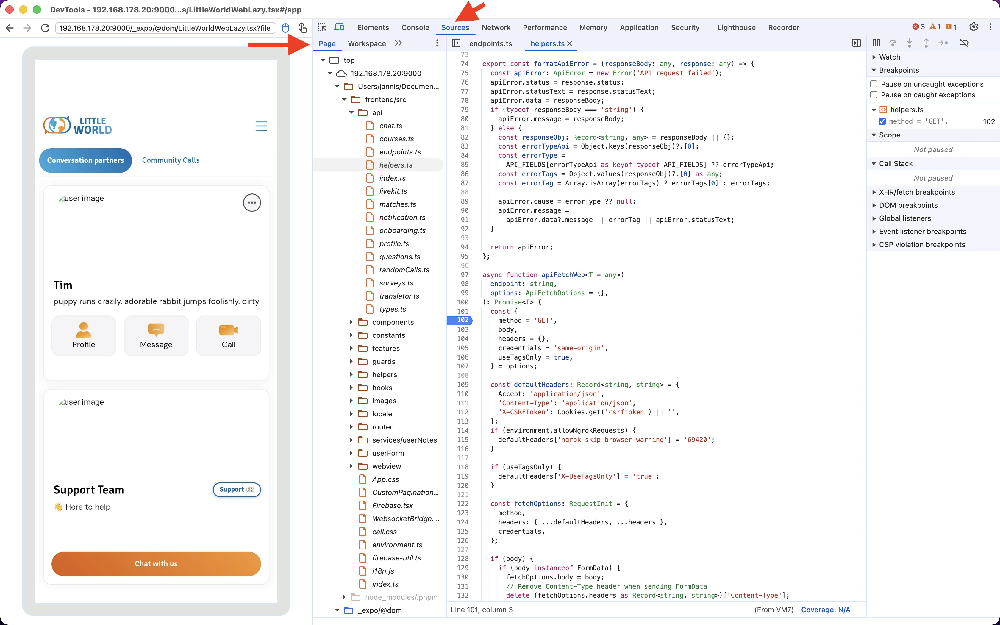
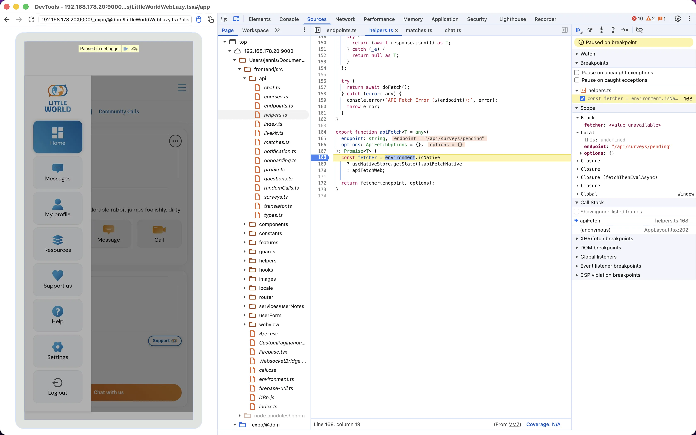

# Development

## Prerequisites

- Node.js 24 (see [`.nvmrc`](.nvmrc))
- pnpm (version pinned in [`package.json`](package.json), `corepack enable` picks it up)
- Xcode (iOS) and/or Android Studio (Android), only for local builds

Use `pnpm exec` for local binaries (`expo`, `eas`, ...), not `npx`.

## Setup

```bash
git clone --recurse-submodules https://github.com/a-little-world/little-world-native
cd little-world-native

# already cloned without submodules:
git submodule update --init --recursive

# hide formatting-only commits from git blame
git config blame.ignoreRevsFile .git-blame-ignore-revs

pnpm install
```

## Configuration

Edit [`environment.ts`](environment.ts) at the repo root to choose the backend:

```ts
export const environment: Environment = {
  backendUrl: 'http://localhost:8000',
  ...
};
```

- Copied to `frontend/src/environment.ts` on every `pnpm start`. Don't edit the copy.
- On a physical device, use your machine's LAN IP instead of `localhost`.
- Native variant config (bundle ID, Firebase, Sentry) lives in [`environments/`](environments). Local builds use [`env.ts`](environments/env.ts) (Dev variant); CI swaps in [`env.staging.ts`](environments/env.staging.ts) / [`env.prod.ts`](environments/env.prod.ts).

## Running

```bash
pnpm start
```

Syncs [`environment.ts`](environment.ts), builds the frontend type declarations, then starts Metro on port 9000. Extra flags are passed through to `expo start`, e.g. `pnpm start --clear` or `pnpm start --tunnel`.

Everything else is done from the Metro terminal:

| Key                   | Action                                       |
| --------------------- | -------------------------------------------- |
| `s`                   | switch between development build and Expo Go |
| `a` / `i` / `w`       | open on Android / iOS / web                  |
| `shift+a` / `shift+i` | choose Android / iOS device or simulator     |
| `r`                   | reload app                                   |
| `m`                   | toggle dev menu                              |
| `?`                   | show all commands                            |

Native modules (LiveKit, Firebase) need a development build. Rebuild only when native code or dependencies change; JS changes load from Metro.

### Behind a reverse proxy

For serving Metro through a public domain that points to your machine (e.g. via NetBird, Tailscale), such as HTTPS for testing video calls on a phone.

Unless the proxy listens on port 9000 and forwards that port to your machine, set `EXPO_PACKAGER_PROXY_URL`:

```bash
EXPO_PACKAGER_PROXY_URL=https://<public-domain> pnpm start
```

Otherwise the app tries to load the bundle from `<public-domain>:9000`.

## Development builds

Profiles ([`eas.json`](eas.json)):

- `simulator`: iOS simulator
- `development`: physical devices (iOS + Android), Android emulator

Some features only work on a physical device, not in a simulator/emulator:

- push notifications
- app integrity checks

### EAS cloud

Requires access to the Expo project (`pnpm exec eas login`).

```bash
pnpm exec eas build --platform "$PLATFORM" --profile "$PROFILE"
```

- `PLATFORM`: `ios` or `android`
- `PROFILE`: see above

Install the latest build on a simulator / emulator:

```bash
pnpm exec eas build:run --platform "$PLATFORM"
```

### EAS local

Same build, run on your machine. Requires Xcode / Android Studio.

Also requires access to the Expo project: signing credentials are fetched from EAS (`credentialsSource: remote`).

```bash
pnpm exec eas build --platform "$PLATFORM" --profile "$PROFILE" --local
```

Writes the artifact (`.ipa`, `.apk`, `.tar.gz`, ...) to the repo root.

### Without Expo access

Debug build with local signing, installed directly on a simulator / connected device. Requires Xcode / Android Studio.

```bash
pnpm exec expo run:ios
pnpm exec expo run:android
```

Add `-d` to pick a device.

### GitHub Actions

**Actions -> Build Application -> Run workflow** ([`build-application.yml`](.github/workflows/build-application.yml)):

- pick profile, backend URL and platforms
- `buildLocally`: build in the GitHub runner instead of on EAS

On PRs, adding the label `build-android` or `build-ios` builds that platform on every push.

## Checks

Same as CI ([`checks.yml`](.github/workflows/checks.yml)):

```bash
pnpm lint
pnpm typecheck
pnpm format:check   # or: pnpm format
pnpm exec expo-doctor
```

E2E tests live in the `e2e_simulations/` submodule. See its README.

## Debugging

`frontend/` runs in a WebView, rendered as a [DOM component](https://docs.expo.dev/guides/dom-components/) via [`src/components/blocks/LittleWorldWebLazy.tsx`](src/components/blocks/LittleWorldWebLazy.tsx). Debug it with the DevTools of any Chromium browser (Chrome, Edge, Brave, ...).

### `frontend/` on Android

WebView debugging is enabled in dev via `webviewDebuggingEnabled` in [`DomWebViewHost.tsx`](src/components/blocks/DomWebViewHost.tsx).

1. Enable USB debugging on the phone and connect it (USB or wireless).
2. Check the connection:

   ```bash
   adb devices
   ```

3. Open a screen that renders the web content, so the DOM component is mounted. Currently always the case: [`app/index.tsx`](app/index.tsx) renders `DomWebViewHost`.
4. Open `chrome://inspect` in the browser and click **inspect** on the WebView entry. If that fails, use **inspect fallback**.

   

5. Optional: you can control the app from the screencast on the left and toggle between mouse and touch input in its toolbar.

   

6. Open the **Sources** tab and switch the left sidebar from **Workspace** to **Page**. Sources may take a second to load.

   

7. Quick-open (`Cmd+P` / `Ctrl+P`) a file under `frontend/src/` and set breakpoints.

   

Ignore the "drop a folder to sync edits" prompt in the **Workspace** tab. It's not needed for breakpoints.

### `frontend/` without a device

Press `w` in Metro. On web the DOM component renders inline, so `frontend/` is debuggable in the browser's DevTools. Not the device runtime, though.

## Troubleshooting

### Metro: stale cache, "Unable to resolve module"

Usually stale caches, not a dependency issue. Stop Metro, then:

```bash
watchman watch-del "$PWD"
watchman watch-project "$PWD"
pnpm start --clear
```

Still broken: `rm -rf node_modules && pnpm install`.

### iOS: `error: exportArchive Copy failed`

1. Find the `.xcdistributionlogs` path printed a few lines above the error.
2. If `IDEDistributionPipeline.log` ends with `rsync: ... --extended-attributes: unknown option`, a non-Apple rsync (e.g. Homebrew) is first in `PATH`.
3. Verify:

   ```bash
   rsync --extended-attributes --version   # fails -> wrong rsync
   ```

4. Remove it or make sure `/usr/bin/rsync` comes first in `PATH`.
