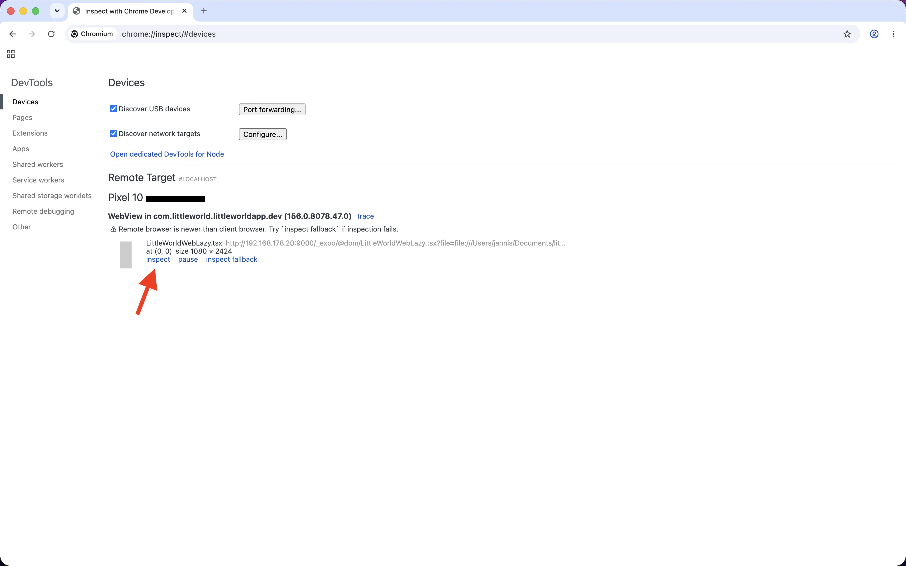
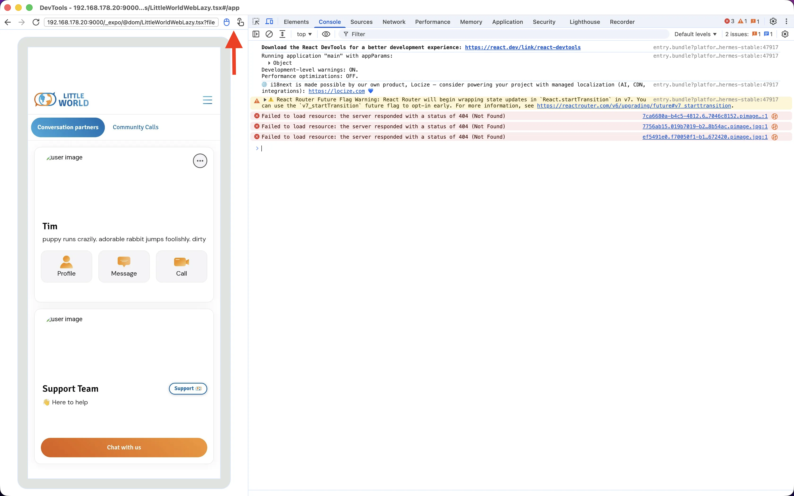
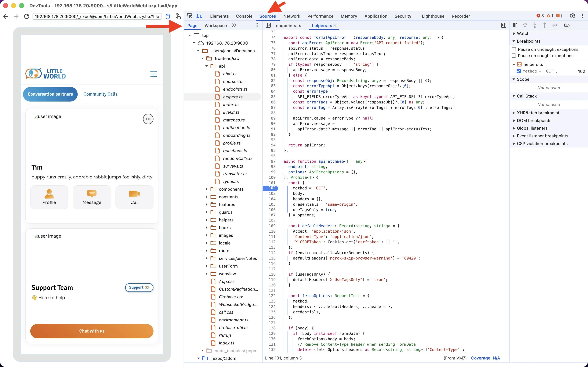
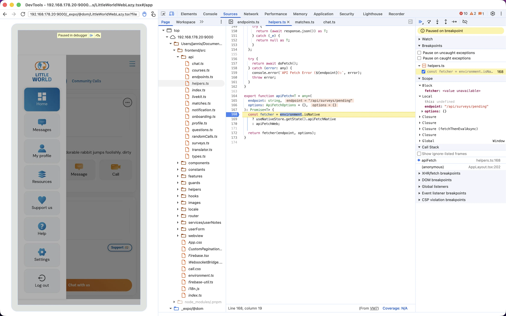
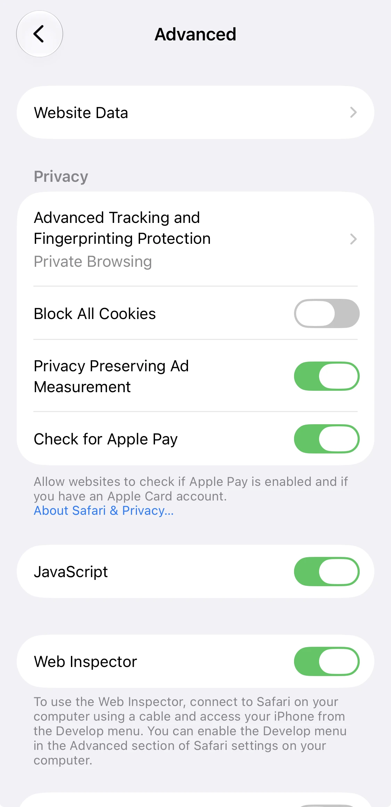
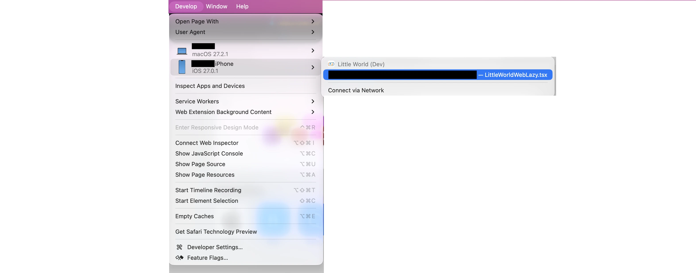

# Debugging

## Debug Panel

In-app panel ([`DebugPanel.tsx`](../src/components/blocks/DebugPanel.tsx)) with app info, backend URL override, auth tokens, [integrity bypass](DEVELOPMENT.md#simulator--emulator-login), DOM communication, network requests and React errors. Available in all builds.

1. Tap the bottom-right corner of the screen 7 times.
2. Enter the developer secret (ask the team).

Once unlocked, a single tap on that corner toggles the panel.

## `frontend/`

`frontend/` runs in a WebView, rendered as a [DOM component](https://docs.expo.dev/guides/dom-components/) via [`src/components/blocks/LittleWorldWebLazy.tsx`](../src/components/blocks/LittleWorldWebLazy.tsx). WebView debugging is enabled in dev via `webviewDebuggingEnabled` in [`DomWebViewHost.tsx`](../src/components/blocks/DomWebViewHost.tsx).

The DOM component is mounted as soon as the app starts: [`app/index.tsx`](../app/index.tsx) always renders `DomWebViewHost`.

### Android: Chrome DevTools

Works with any Chromium browser (Chrome, Edge, Brave, ...).

1. Enable USB debugging on the phone and connect it (USB or wireless).
2. Check the connection:

   ```bash
   adb devices
   ```

3. Open `chrome://inspect` in the browser and click **inspect** on the WebView entry. If that fails, use **inspect fallback**.

   

4. Optional: you can control the app from the screencast on the left and toggle between mouse and touch input in its toolbar.

   

5. Open the **Sources** tab and switch the left sidebar from **Workspace** to **Page**. Sources may take a second to load.

   

6. Quick-open (`Cmd+P` / `Ctrl+P`) a file under `frontend/src/` and set breakpoints.

   

Ignore the "drop a folder to sync edits" prompt in the **Workspace** tab. It's not needed for breakpoints.

### iOS: Safari Web Inspector

Requires Safari on a Mac.

1. Enable the Develop menu: **Safari -> Settings -> Advanced -> Show features for web developers**.
2. Physical device only: enable **Settings -> Apps -> Safari -> Scroll all the way down -> Advanced -> Web Inspector** on the iPhone and connect it via USB.

   

3. **Safari -> Develop -> _device or simulator_ -> _WebView entry_**.

   

4. Open the **Sources** tab and find files under `frontend/src/` to set breakpoints.

   At the time of writing this doesn't work, and it might never work: Safari doesn't load the source maps, so **Sources** only lists the bundled `frontend/src/index.bundle`. For breakpoints in `frontend/src/`, use [Android](#android-chrome-devtools) or [web](#without-a-device).

### Without a device

Press `w` in Metro. On web the DOM component renders inline, so `frontend/` is debuggable in the browser's DevTools. Not the device runtime, though.
